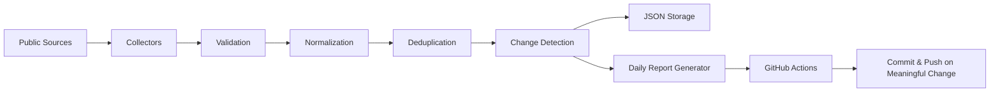
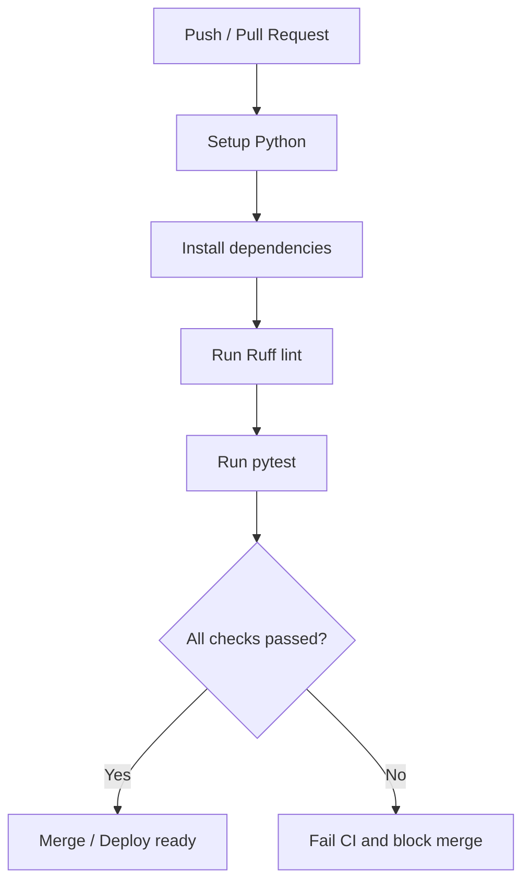

# OpenPulse

[](https://github.com/SyedMuqeem03/OpenPulse/actions/workflows/ci.yml)
[](https://github.com/SyedMuqeem03/OpenPulse/actions/workflows/collect.yml)
[](https://www.python.org/)
[](https://github.com/SyedMuqeem03/OpenPulse)

## Project status

OpenPulse is a live, zero-cost intelligence pipeline that continuously monitors public security and DevOps signals. The project is currently active, tested, and configured to run on a daily schedule using GitHub Actions while committing only when meaningful updates are present.

OpenPulse is a zero-cost daily intelligence pipeline for public security and DevOps data. It collects relevant information from trusted public feeds, normalizes it, removes duplicates, detects meaningful changes, and writes a daily report to the repository.

## What it does

- Security collection from CISA KEV, NVD, and OSV
- DevOps release tracking for key projects such as Docker, Kubernetes, Terraform, Jenkins, Prometheus, and Grafana
- Public service-status monitoring from GitHub and Cloudflare
- Structured storage in JSON files under `data/`
- Daily markdown and JSON reports under `reports/`
- GitHub Actions automation that only commits when the data has changed meaningfully

## Why it matters

OpenPulse is built to answer practical monitoring questions quickly:

- Which known vulnerabilities are becoming relevant right now?
- Which key open-source and DevOps projects have shipped important releases?
- Are public service providers reporting incidents or degraded performance?
- What changed since the last run, without creating noisy empty commits?

This makes it useful as a personal security watchtower, a DevOps awareness feed, or a small operational intelligence dashboard stored in Git.

## Features at a glance

| Area | Capability |
| --- | --- |
| Security | CISA KEV, NVD, and OSV advisory collection |
| DevOps | Release tracking for Docker, Kubernetes, Terraform, Jenkins, Prometheus, and Grafana |
| Status | GitHub and Cloudflare service status monitoring |
| Data quality | Validation, normalization, deduplication, and change detection |
| Storage | JSON persistence for long-term repository history |
| Reporting | Daily markdown and JSON reports with highlights |
| Automation | Commit only when data is meaningfully changed |

## Architecture



This pipeline keeps the system simple, transparent, and easy to extend with more data sources over time.

## CI workflow diagram



The CI pipeline enforces code quality and regression safety before changes are merged.

## Local setup

1. Create and activate a Python virtual environment.
2. Install project dependencies:

   ```bash
   python -m pip install --upgrade pip
   pip install -r requirements.txt
   pip install -e .
   ```

3. Run the collector pipeline:

   ```bash
   python -m openpulse.main
   ```

## Repository outputs

- `data/security/security_records.json` — security records
- `data/devops/devops_records.json` — release and DevOps records
- `data/devops/status_records.json` — status feed data
- `reports/latest.md` — latest daily markdown report
- `reports/latest.json` — latest daily JSON report
- `reports/history/` — historical snapshots

## Automation behavior

The daily workflow runs on a schedule and can also be triggered manually from GitHub Actions.

It will:

- collect fresh public data
- write updates into the repository
- decide whether the change is meaningful
- create a conventional commit message when needed
- commit and push only if a real update exists

This avoids empty, noisy, or meaningless automation commits.

## Safety and constraints

- No paid infrastructure required
- No secrets are stored in the repository
- Public data sources are used only
- The project is designed to be useful, transparent, and low-noise

## Validation

The project includes pytest coverage for security, release, report, and automation behavior.

```bash
pytest -q
```
